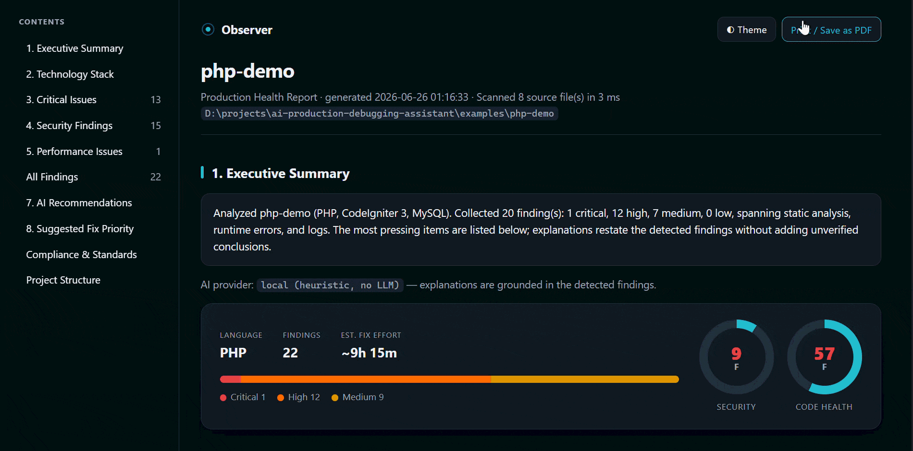

# Observer

**Audit a client or legacy codebase locally and generate a shareable report in one command.**

**Current release: v0.8.2**

Useful for legacy code reviews, application handovers, local security triage, and everyday development. Observer Community is MIT-licensed, runs on Windows, macOS, and Linux, and requires no account or hosted service.


## ⬇️ Get Observer

Grab the single binary for your OS. Core scanning requires no additional runtime or account; optional analysis engines are installed separately:

| Windows | macOS (Apple Silicon) | macOS (Intel) | Linux |
|:---:|:---:|:---:|:---:|
| [**Download**](https://github.com/sanks205/getobserver/releases/download/v0.8.2/observer_windows_amd64.exe) | [**Download**](https://github.com/sanks205/getobserver/releases/download/v0.8.2/observer_darwin_arm64) | [**Download**](https://github.com/sanks205/getobserver/releases/download/v0.8.2/observer_darwin_amd64) | [**Download**](https://github.com/sanks205/getobserver/releases/download/v0.8.2/observer_linux_amd64) |

Verify the binary before running it, then follow [Installation](#installation).


### Verify your download before running it

Binaries are currently **unsigned**. Download [SHA256SUMS.txt for v0.8.2](https://github.com/sanks205/getobserver/releases/download/v0.8.2/SHA256SUMS.txt) and compare the entry for your exact filename with the checksum calculated locally. Always use the checksum file from the same release as your binary.

**Windows (PowerShell):**

~~~powershell
Get-FileHash -Algorithm SHA256 -LiteralPath .\observer_windows_amd64.exe
~~~

**macOS:**

~~~bash
# Apple Silicon; substitute observer_darwin_amd64 on Intel
shasum -a 256 observer_darwin_arm64
~~~

**Linux:**

~~~bash
# Substitute observer_linux_arm64 on ARM64
sha256sum observer_linux_amd64
~~~

If the values differ, do not run the binary. A matching checksum verifies consistency with the published checksum; it does not replace code signing or notarization.

On Windows, run the downloaded binary as `.\observer_windows_amd64.exe`.
On macOS/Linux, make the downloaded binary executable with `chmod +x` and run it using its relative or absolute path.
For the examples below, rename it to `observer` (`observer.exe` on Windows) and put it on your `PATH`, or substitute its actual path.

Then point it at a project:

```bash
observer analyze . --out report.html

# Exclude project-specific generated or fixture directories by basename
observer analyze . --exclude-dir fixtures,generated --out report.html
```

You get **one self-contained `report.html`** — grouped findings, heuristic Security and Code Health scores, and remediation recommendations for review. Fully offline; open it in a browser or print to PDF.

---

> A developer-friendly tool that analyzes an application/codebase and generates a
> **production health report** - combining static analysis, technology detection,
> runtime error analysis, log analysis, dependency analysis, infrastructure and
> config checks (Dockerfile / compose / Kubernetes / .env / web-server), and
> optional deterministic remediation guidance.

The goal: help developers quickly identify production issues without manually
searching through huge codebases and server logs.

The CLI binary is named **`observer`**.

> **Status:** The local CLI, technology detection, static analysis, runtime and
> log analysis, HTML reporting, packaging, dashboard, opt-in dependency CVEs, and
> CI workflow are implemented. Observer Pro adds local reporting and repeat-audit
> workflow features; no hosted service is required.

---

## Demo



Point it at any codebase and get one self-contained HTML report - no server, no
account, no instrumentation:

```bash
observer analyze ./examples/php-demo --guidance --out report.html
```

Observer detects the stack, flags security, runtime, and dependency issues with
severity and suggested fixes, scores the project on **Security** and **Code
Health**, and writes a shareable `report.html` you can open or print to PDF.

Observer Community is free and MIT licensed and produces detailed HTML, JSON, CSV, and SARIF outputs. Observer Pro adds an organization-ready PDF with document control, grouped remediation planning, bookmarks, hyperlinks, optional client branding, and repeat-audit workflow features without a hosted dependency.

---


## Coverage and limitations

| Input | Coverage |
|---|---|
| Source code | Built-in heuristic rules; depth varies by language and framework |
| PHP | Code and configuration checks, Composer manifests, PHP runtime agent, and optional PHPStan |
| JavaScript / TypeScript | Code heuristics, npm manifests, and optional ESLint |
| Python | Code heuristics, supported dependency manifests, and optional Bandit |
| Go | Code heuristics, Go modules, and optional gosec |
| Other languages | Technology detection and applicable generic checks; optional Semgrep rules can extend coverage |
| Infrastructure | Dockerfile, Compose, Kubernetes, environment, and web-server configuration checks |
| Logs and runtime events | Supplied application logs and events captured by the PHP agent |

Technology detection does not imply full security coverage. Optional tools must be installed separately, and Semgrep coverage depends on the selected rules.

Security and Code Health scores are heuristic summaries. Findings can carry CWE and OWASP Top 10 (2021) tags where mapped; the scores are not certification or a guarantee of standards compliance.

False positives and missed issues are possible. A clean report does not prove that an application is secure. Review findings and test remediation changes. Observer complements code review, testing, and deeper semantic analysis.

No reproducible detection benchmark or false-positive rate is claimed here. See the [comparison evidence requirements](docs/marketing/COMPARISON-VALIDATION.md).

---

## How Observer compares

Observer is a local audit snapshot, not a replacement for a full semantic SAST
platform or production monitoring service. It combines lightweight built-in
heuristics with optional local tools and produces one report without requiring
an account.

| | **Observer** | **Full SAST platforms** | **Cloud security tools** | **Production monitoring** |
|---|---|---|---|---|
| **Primary job** | Private audit snapshot and handover report | Deep continuous code analysis | Hosted code/dependency analysis | Live errors and telemetry |
| **Setup** | One local binary | Local, self-hosted, or cloud setup | Account and cloud workflow | Application instrumentation |
| **Analysis depth** | Curated heuristics; optional local engines | Deeper language and data-flow analysis | Varies by vendor | Runtime rather than source audit |
| **Offline use** | Default; enforce with `--assert-offline` | Available in some products/editions | Usually cloud-dependent | Usually cloud-dependent |
| **Best fit** | Client audits, legacy reviews, handovers, air-gapped work | Large continuous engineering programs | Managed security programs | Operating live applications |

Use Observer when privacy, fast setup, and a readable point-in-time report matter.
Use a deeper SAST platform when you need broad semantic analysis, centralized
policy management, or large-team governance. The tools can complement each
other.

---

## Gate changed code

Scan changed lines to review new findings before merging or committing code. Observer can compare against HEAD, a base branch, or staged changes.

```bash
# Scan only what you just changed, vs the last commit
observer analyze . --diff

# PR review — only the lines this branch added since it forked from main
observer analyze . --diff-base main --fail-on High

# Pre-commit gate — block a commit if staged changes add a High-severity finding
observer install-hook            # one-time; bypass a commit with `git commit --no-verify`
```

Add `--attest attestation.json` to emit a machine-readable local scan record for
a PR or audit trail. It records the tool version, exact Git commit, branch and dirty
state, scan scope, enabled-engine outcomes, finding counts, and final status. Observer Pro can add an HMAC companion file for local workflow integrity;
this is not a third-party signature or certification.

---

## Privacy & air-gapped use

Observer scans locally and is **offline by default**. There is no account, no telemetry, and no phone-home. The only features that
touch the network are explicitly opt-in: `--cve` (OSV.dev dependency lookup), `--semgrep` when using `auto` or registry rules, and the `--email` / `--slack` / `--teams` / `--webhook`
notifiers. Leave them off and the scan is entirely local. Dependency lookups disclose dependency information to OSV.dev; notifications and emailed reports can disclose project details to their configured recipients. Review reports before sharing them.

For regulated, air-gapped, or client-confidential work you can make that guarantee
**enforceable**:

```bash
observer analyze ./my-project --assert-offline
```

--assert-offline rejects network-capable options. When using --semgrep, it requires SEMGREP_CONFIG to point to an existing local file or directory. All remediation guidance remains deterministic and local.

Inspect the privacy contract and available optional local engines without scanning:

```bash
observer doctor
```

During an enforced scan, Observer prints
`Offline mode: no network I/O.` so the enforced mode is visible in an audit log. Ideal for finance,
healthcare, government/defense, or auditing a client's code under NDA — the code stays
put.

---

## Installation

### Download a prebuilt binary (recommended)

Observer ships as a **single self-contained executable** — no additional runtime for core scanning. Optional analysis engines are installed separately. Download the binary for your OS
from the [Releases](https://github.com/sanks205/getobserver/releases) page and run it:

| OS | File |
|---|---|
| Windows | `observer_windows_amd64.exe` |
| macOS (Apple Silicon) | `observer_darwin_arm64` |
| macOS (Intel) | `observer_darwin_amd64` |
| Linux | `observer_linux_amd64` / `observer_linux_arm64` |

On macOS/Linux, make it executable: `chmod +x observer_*` (optionally rename to `observer`).

Follow the [checksum verification instructions](#verify-your-download-before-running-it) before running a downloaded binary.

### Package-manager definitions

The repository includes [Scoop](packaging/scoop/observer.json) and [Homebrew](packaging/homebrew/observer.rb) definitions with release-specific SHA-256 checksums. These files do not establish a dedicated public tap or bucket. The verified binary download above is the recommended installation route.

### Build from source

Requires [Go 1.26+](https://go.dev/dl/).

```bash
git clone https://github.com/sanks205/getobserver.git
cd getobserver
go build -o observer ./cmd/cli
```

On Windows, build explicitly with `go build -o observer.exe ./cmd/cli`. To cross-compile release binaries for all
platforms: `pwsh scripts/build-release.ps1` (or `./scripts/build-release.sh`).

---

## Usage

```bash
# Scan a project and generate report.html
observer analyze ./examples/php-demo

# Choose a custom output path
observer analyze ./examples/php-demo --out booking-report.html

# Include runtime errors captured by observer-agent (see observer-agent/)
observer analyze ./examples/php-demo --runtime /tmp/observer-runtime.jsonl

# Include application log analysis in the report
observer analyze ./examples/php-demo --logs ./examples/php-demo/logs

# Or analyze logs on their own (prints a summary)
observer analyze-log ./examples/php-demo/logs

# Launch the local web dashboard (no command line needed after this):
observer serve            # open http://127.0.0.1:7777 — paste a folder, click Scan
# Past scans, stack, issue counts, and "new since last scan" appear on one page.
# Search scans by project name or path, pick a per-page size (10/25/50), and page
# through history. Each scan row shows a signed "Change" column: +N (orange) new
# issues since the previous scan, -N (green) better, 0 flat.
# Open any report and use the browser's Print → Save as PDF.

# Add deterministic remediation guidance
observer analyze ./examples/php-demo --guidance

# Choose what to report: only some categories, and/or a minimum severity
observer analyze ./examples/php-demo --categories "Security,Database" --min-severity High

# Scan dependencies for known vulnerabilities (OSV.dev; needs network)
observer analyze ./my-project --cve

# Air-gapped / regulated: guarantee NO network I/O — refuses --cve/--email/--slack/
# --teams/--webhook and keeps deterministic guidance local. Prints "Offline mode: no network I/O."
observer analyze ./my-project --assert-offline

# Deeper, multi-language detection if you have Semgrep installed (auto-skips if not)
observer analyze ./my-project --semgrep

# Auto-detect and fold in other engines you already have (each auto-skips if absent):
observer analyze ./my-project --phpstan --bandit --gosec --eslint

# CI policy: these engines must complete; unavailable/failed means INCOMPLETE (exit 3)
observer analyze ./my-project --require-engine phpstan,semgrep --fail-on High

# CI: emit SARIF and fail the build on High+ findings (see docs/CI.md)
observer analyze . --sarif observer.sarif --fail-on High

# Export findings for other tools / spreadsheets
observer analyze . --json findings.json --csv findings.csv

# Notify a channel after scanning (Slack / Teams / generic webhook)
observer analyze . --slack "$SLACK_WEBHOOK"   # or --teams <url> / --webhook <url>

# Adopt on an existing codebase: record a baseline, then report only NEW issues
observer analyze . --write-baseline .observer-baseline.json
observer analyze . --baseline .observer-baseline.json --fail-on Medium

# Scan only what changed — vs HEAD, a base branch, or staged changes
observer analyze . --diff --fail-on High
observer analyze . --diff-base main --fail-on High
observer analyze . --diff-staged --out "" --attest attestation.json

# Install a git pre-commit hook that gates staged changes (bypass: git commit --no-verify)
observer install-hook

# Email the report (configure SMTP via env vars; see below)
observer analyze ./examples/php-demo --email "dev@example.com,lead@example.com"
```

### Email configuration

`--email` attaches the HTML report and sends a summary via SMTP. Configure with env vars:

| Variable | Purpose | Default |
|---|---|---|
| `SMTP_HOST` | SMTP server host | _(required to send)_ |
| `SMTP_PORT` | Port (587 STARTTLS, 465 implicit TLS, 25) | `587` |
| `SMTP_USER` / `SMTP_PASS` | Credentials (omit for an open relay) | _(none)_ |
| `SMTP_FROM` | From address | `SMTP_USER` |
| `OBSERVER_SMTP_DRYRUN` | Set to `1` to compose a `.eml` file instead of sending (no server needed) | _(off)_ |

```bash
# Verify composition offline without a mail server:
OBSERVER_SMTP_DRYRUN=1 SMTP_FROM=observer@example.com \
  observer analyze ./examples/php-demo --email dev@example.com
# -> writes report.html.eml next to the report
```

### Remediation guidance

Use --guidance to add deterministic, rule-based explanations, prioritization, and possible remediation patterns. It runs locally, uses no API key, and requires developer review.

### Scan timeout

Deep scans (PHPStan + Semgrep over thousands of files) run under a single time budget.
Raise or lower it with `OBSERVER_SCAN_TIMEOUT` — a Go duration string like `15m` or `30m`:

| Variable | Purpose | Default |
|---|---|---|
| `OBSERVER_SCAN_TIMEOUT` | Max time for a deep scan before it is stopped (the engine process tree is killed on timeout, so no orphaned processes) | `15m` (hard cap `60m`) |

```bash
OBSERVER_SCAN_TIMEOUT=30m observer analyze ./my-project --phpstan --semgrep
```

### Example output

Illustrative output from the PHP demo; counts vary with project contents and scan options.

```
Scanning ./examples/php-demo ...

Project:   php-demo
Language:  PHP
Framework: CodeIgniter 3 3.1.11 [High]
Database:  MySQL [High]

Files:       9
Directories: 5

Code structure:
  Controllers: 2
  Models:      1
  Services:    1
  Config:      2

Report written to .../report.html
```

It also writes a self-contained **`report.html`** with the technology overview,
detected signals, code structure, and file-type breakdown.

---


## Community and Pro

**Community** provides local auditing, rule-based remediation guidance, and development workflows.

**Observer Pro** adds professional audit deliverables and integrated repeat-audit workflows through **one annual all-access subscription at $89/year**.

| Capability | Community | Pro |
|---|:---:|:---:|
| Local CLI, core rules, rule-based guidance, and dashboard | Yes | Yes |
| HTML, JSON, CSV, SARIF, CI gates, baselines, and changed-code scans | Yes | Yes |
| Optional local analysis engines | Yes | Yes |
| Premium framework-specific rules | - | Yes |
| Professional PDF with document control, navigation, grouped remediation planning, and optional branding | - | Yes |
| Integrated recurring scans and dashboard scheduling | - | Yes |
| Git-history secret review and CycloneDX SBOM export | - | Yes |
| HMAC companion for local scan attestations | - | Yes |

[Get Observer Pro - $89/year](https://observerly1.gumroad.com/l/observer-pro-offline-code-audit)

There are no separate add-on purchases in the current offer.

Community can be automated through CI, cron, or Windows Task Scheduler. Community HTML reports can be printed to PDF with Community Edition branding; Pro provides a clean, brandable professional PDF.

See the [edition comparison](docs/FREE-VS-PRO.md) for details.

Pro is distributed separately. Initial activation requires an online license check. Annual licenses are machine-bound, with local expiry verification and renewal handling; cached activation does not grant perpetual access. See the product listing and supplied Pro instructions for activation and renewal terms.

---

## Contributing

See [CONTRIBUTING.md](CONTRIBUTING.md). Issues and PRs welcome.

## License

[MIT](LICENSE)
